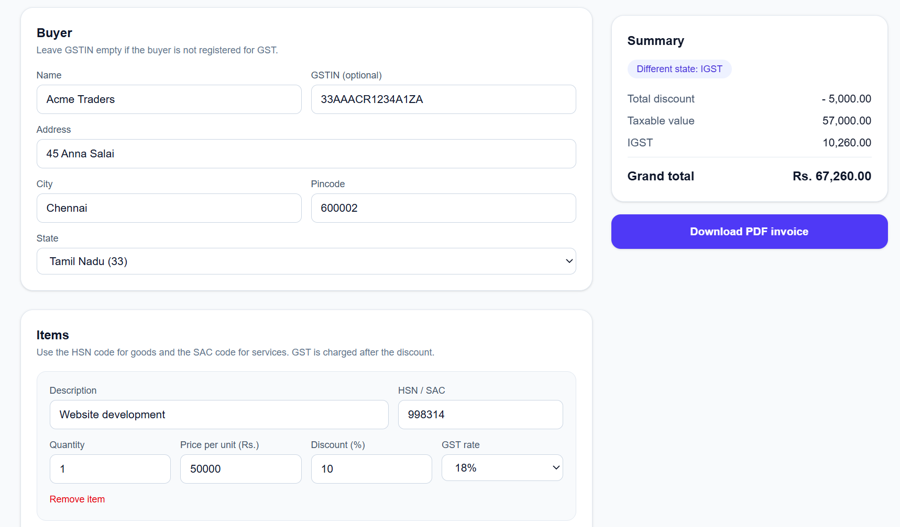
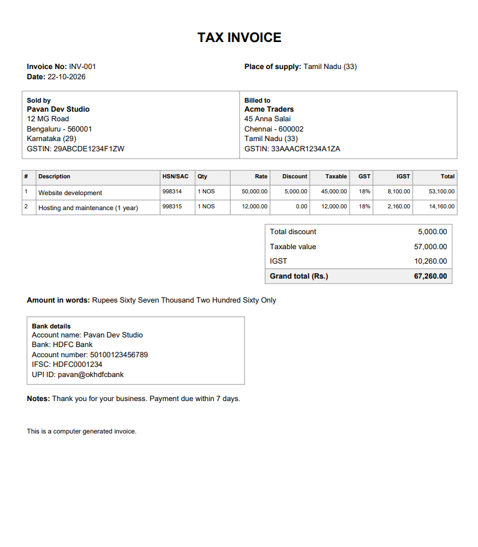

# GST Invoice API

A small open-source project I built to create GST invoices in India. You give it the invoice details (seller, buyer, items), and it works out CGST / SGST / IGST, rounds the total, and gives you a PDF. I also made a simple web page on top of it so you don't have to write JSON by hand.

I built this to learn how a real project is made from start to end (API, tests, Docker, frontend). I also picked it because freelancers like me need GST invoices all the time and it felt like something people could actually use.

## What it can do

- Takes seller, buyer and item details and calculates the tax
- Uses CGST + SGST when the seller and the place of supply are in the same state, and IGST when they are in different states
- Discount (%) on each item. GST is charged after the discount
- Rounds the final total to the nearest rupee and shows the round off
- Checks the GSTIN format and also its last check character, so typos get caught
- Writes the amount in words the Indian way (lakh, crore)
- Downloads a PDF, with optional bank details and UPI ID
- Simple web page that shows the totals live while you type
- Runs with one Docker command

## Tech used

- Python, FastAPI, Pydantic
- ReportLab (for the PDF)
- pytest (for tests)
- Next.js (TypeScript) and Tailwind CSS for the web page
- Docker and GitHub Actions

## How to run it

### With Docker (easiest)

Install Docker Desktop, make sure it is running, then:

    git clone https://github.com/Pavangowda-dev/gst-invoice-api.git
    cd gst-invoice-api
    docker compose up --build

Then open:

- http://localhost:3000 for the web page
- http://localhost:8000/docs for the API docs

### Without Docker

Backend (Windows PowerShell):

    python -m venv venv
    venv\Scripts\activate
    pip install -r requirements.txt
    uvicorn app.main:app --reload

On Mac or Linux, use `source venv/bin/activate` instead of the activate line.

Frontend (in a second terminal):

    cd frontend
    npm install
    npm run dev

## Using the API

There are two endpoints. Both take the same JSON.

- `POST /invoices/calculate` gives back the calculated invoice as JSON
- `POST /invoices/pdf` gives back the PDF file

The easiest way to try them is the docs page at http://localhost:8000/docs (click "Try it out"). A small example:

    {
      "invoice_number": "INV-001",
      "seller": {
        "name": "Test Seller",
        "gstin": "29ABCDE1234F1ZW",
        "address": {
          "line1": "12 MG Road",
          "city": "Bengaluru",
          "state_code": "29",
          "pincode": "560001"
        }
      },
      "buyer": {
        "name": "Test Buyer",
        "address": {
          "line1": "45 Anna Salai",
          "city": "Chennai",
          "state_code": "33",
          "pincode": "600002"
        }
      },
      "items": [
        {
          "description": "Website development",
          "hsn_sac": "998314",
          "quantity": 1,
          "unit_price": 50000,
          "gst_rate": 18
        }
      ]
    }

Things that are optional: buyer GSTIN (for customers without GST), `discount_percent` on items, `place_of_supply`, `bank_details` and `notes`. The money in the response comes back as strings like `"9000.00"` on purpose, so there are no float problems.

## Running the tests

    python -m pytest

There are 41 tests. They cover the tax calculation, rounding, discounts, GSTIN checks, amount in words, the PDF and the API endpoints.

## Project structure

    gst-invoice-api/
    ├── app/
    │   ├── main.py            API endpoints
    │   ├── schemas.py         data models and validation
    │   ├── calculator.py      the GST calculation
    │   ├── gstin.py           GSTIN format and check character
    │   ├── formatting.py      Indian number format and amount in words
    │   ├── pdf_generator.py   makes the PDF
    │   └── states.py          GST state codes and names
    ├── tests/
    ├── frontend/              the Next.js web page
    ├── Dockerfile
    └── docker-compose.yml

## What I learnt

- Never use float for money. In Python `0.1 + 0.2` is not exactly `0.3`, so I used `Decimal` everywhere and rounded to the paisa at the right places.
- How GST actually works: CGST + SGST for the same state, IGST for different states, and the tax is on the price after discount.
- A GSTIN is not just any 15 characters. The last one is a check character worked out from the first 14, so I can catch typos.
- How to use Pydantic to check the input, so wrong data is stopped before it reaches my calculation code.
- Writing tests as I go. They saved me many times when I changed something.
- How to put a project in Docker and run frontend and backend together with one command.
- How to connect a Next.js page to a FastAPI backend (and what CORS is).

## Problems I faced

- **Docker would not start.** I got an error saying it could not connect to the Docker API. The reason was simple: Docker Desktop was not running. I started it and waited for "Engine running".
- **GST rates changed.** In September 2025 the 12% and 28% slabs were mostly removed, but many websites still show the old ones. I kept the allowed rates in one list so they are easy to update.
- **The frontend could not talk to the API.** The page on port 3000 is blocked from calling the API on port 8000 until you allow it. I added CORS in FastAPI.
- **A name like "Sharma & Sons" can crash the PDF.** ReportLab reads text like XML, so `&` and `<` must be escaped. I fixed it and added a test for it.
- **The rupee symbol does not show.** The default PDF font does not have it, so the PDF says "Rs." for now.
- **Big amounts did not fit in the table.** Things like 45,00,000.00 spilled out of their columns, so I made the columns narrower and the Discount column only shows when an invoice really has a discount.
- **My old sample GSTIN stopped working** after I added the check character test. I had to make new valid sample GSTINs.

## Result

- For one item of Rs. 50,000 at 18%, with a seller in Karnataka and a buyer in Tamil Nadu, I get IGST Rs. 9,000 and a total of Rs. 59,000. If both are in Karnataka it becomes CGST 4,500 and SGST 4,500.
- All 41 tests pass, and GitHub Actions runs them on every push.
- The whole thing starts with `docker compose up --build`, and I can download a proper PDF invoice from the web page.

## What I want to add next

- A UPI QR code on the invoice
- Company logo on the PDF
- Saving invoices in PostgreSQL
- The proper rupee symbol in the PDF
- Checking that the state code matches the GSTIN
- Putting it online so people can try it without installing anything

## Please note

I am a student/developer, not a CA. Please check the output before using it for real filing or accounts. GST rules change, and the rates in this project are as of October 2026.

## Contributing

If you find a bug or want to add something, feel free to open an issue or a pull request. Please run `python -m pytest` before sending one.

## License

MIT. See the LICENSE file.